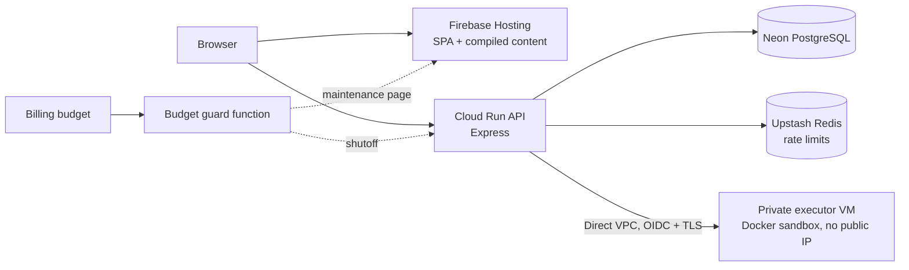

# PrepAlgo - Intelligent Coding Practice Platform

A personalized coding practice platform that provides smart daily question recommendations based on your learning patterns, progress tracking, and adaptive difficulty adjustment.

## Current storage and local development

The backend uses **Neon PostgreSQL** for user data and **Upstash Redis** for optional
shared rate limits. Public response caching is bounded and local to each API instance.
Questions and articles are compiled from `content/` and
served by Firebase Hosting, not loaded from a database.

```bash
npm ci --prefix backend
npm run build:content
# Configure backend/.env with development DATABASE_URL, REDIS_URL and auth settings.
npm --prefix backend run db:migrate
npm --prefix backend start
# In a second terminal:
npm --prefix frontend run dev
```

Set backend `PORT=5000` for the Vite development proxy. See the
[PostgreSQL runbook](docs/POSTGRES_MIGRATION.md) for importing existing Mongo testing
accounts, environment isolation, submission semantics, and production cutover.

Production code execution requires a separately hosted, authenticated Docker executor;
the API deliberately refuses local execution in production. See
[ADR-008](docs/adr/008-code-execution-sandbox.md) and the
[release runbook](DEPLOYMENT_README.md) for executor setup and deployment gates.

## Features

- **Daily recommendations** that adapt to topic mastery, user level and tracked
  outcomes (weak areas, progressive difficulty, spaced repetition, exploration).
- **Coding practice** with Python graded by an isolated private executor, and
  **system-design quizzes** with retry-safe submissions.
- **Progress analytics**: streaks, five-level topic mastery, focus areas.
- Responsive React UI with dark/light themes and Google sign-in.

## Architecture



Details: [docs/ARCHITECTURE_PLAN.md](docs/ARCHITECTURE_PLAN.md#current-architecture).

## Setup

Prerequisites: Node.js 22+, a TLS PostgreSQL database (Neon for hosted
environments), optionally Redis, and Docker for local code execution.

```bash
git clone https://github.com/arsaikia/prep-algo.git && cd prep-algo
npm ci --prefix backend && npm ci --prefix frontend
cp backend/.env.example backend/.env    # DATABASE_URL, JWT_SECRET, GOOGLE_CLIENT_ID, PORT=5000
cp frontend/.env.example frontend/.env  # VITE_GOOGLE_CLIENT_ID
npm run build:content
npm --prefix backend run db:migrate
npm run dev                             # backend (nodemon) + Vite on :5173
```

## Testing

```bash
npm test                         # content build + budget-guard tests
npm --prefix backend test        # unit + PostgreSQL integration (needs a test DATABASE_URL)
npm --prefix frontend run test:regression
npm --prefix frontend run lint
```

## Documentation

| Doc | Covers |
| --- | --- |
| [DEPLOYMENT_README.md](DEPLOYMENT_README.md) | Release runbook: Cloud Run, Firebase, executor, cost guard, rollback |
| [docs/POSTGRES_MIGRATION.md](docs/POSTGRES_MIGRATION.md) | Database setup, Mongo import, backups, cutover, data semantics |
| [docs/RECOMMENDATIONS.md](docs/RECOMMENDATIONS.md) | Recommendation API, mastery, classification, strategies |
| [docs/ARCHITECTURE_PLAN.md](docs/ARCHITECTURE_PLAN.md) | Current architecture and decision history |
| [docs/ARCHITECTURE_DIAGRAMS.md](docs/ARCHITECTURE_DIAGRAMS.md) | Current and historical diagrams |
| [docs/adr/](docs/adr/) | Architecture decision records |
| [frontend/README.md](frontend/README.md) | Frontend development and dev mode |
| [backend/scripts/README.md](backend/scripts/README.md) | Backend maintenance scripts |
| [scripts/budget-guard/README.md](scripts/budget-guard/README.md) | Budget kill-switch |

## License

MIT
