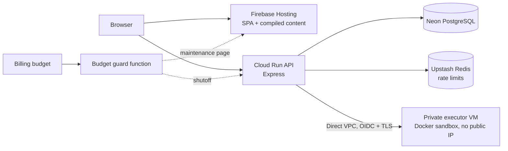

# PrepAlgo - Intelligent Coding Practice Platform

A personalized coding practice platform that provides smart daily question recommendations based on your learning patterns, progress tracking, and adaptive difficulty adjustment.

Stack: React/Vite on Firebase Hosting, Express on Cloud Run, Neon PostgreSQL,
optional Upstash Redis (rate limits), and a private Docker executor VM for code
grading. Questions and articles are compiled from `content/` and served as
static files, not loaded from a database. Sign-in is Google-only.

## Features

- **Daily recommendations** that adapt to topic mastery, user level and tracked
  outcomes (weak areas, progressive difficulty, spaced repetition, exploration).
- **Coding practice** with Python for DSA and JavaScript for four frontend
  exercises, graded by an isolated private executor.
- **System Design learning path** with an interview framework, concept and
  pattern lessons with diagrams, 17 end-to-end case studies, knowledge checks
  and a quick-reference handbook. Practice is self-guided; the
  [AI interview workspace](docs/SD_INTERVIEW_DESIGN.md) is a deferred proposal.
- **Progress analytics**: streaks, five-level topic mastery, focus areas.
- Responsive React UI with dark/light themes and Google sign-in.

## Architecture



Details: [docs/ARCHITECTURE.md](docs/ARCHITECTURE.md).

## Setup

Prerequisites: Node.js 22+, a TLS PostgreSQL database (Neon for hosted
environments), optionally Redis, and Docker for local code execution.

```bash
git clone https://github.com/arsaikia/prep-algo.git && cd prep-algo
npm ci --prefix backend && npm ci --prefix frontend
cp backend/.env.example backend/.env    # DATABASE_URL, JWT_SECRET, GOOGLE_CLIENT_ID, PORT=5000
cp frontend/.env.example frontend/.env  # VITE_GOOGLE_CLIENT_ID
npm run build:content
npm --prefix backend run db:migrate
npm run dev                             # backend (nodemon) + Vite on :5173
```

The Vite proxy expects the backend on port 5000. Local code execution uses
Docker (`CODE_SANDBOX_MODE=auto`); production refuses local execution and needs
the private executor ([ADR-008](docs/adr/008-code-execution-sandbox.md)).

## Project layout

| Path | Contents |
| --- | --- |
| `frontend/` | React SPA ([frontend/README.md](frontend/README.md)) |
| `backend/` | Express API: `routes/`, `controller/`, `models/` + `repositories/` (PostgreSQL), `middleware/`, `utils/sandbox/`, `migrations/`, `tests/` |
| `backend/executor/` | Standalone executor service deployed to the private VM |
| `content/` | Source of truth for problems, quizzes, topics and modules |
| `scripts/content/` | Content compiler and authoring tools |
| `scripts/release/`, `scripts/hosting/` | Rollback guard, Hosting config/artifact retention |
| `scripts/executor/` | Executor packaging, host setup, patching, cert rotation |
| `scripts/budget-guard/` | Budget kill-switch and maintenance mode |
| `deploy-to-cloudrun.sh`, `deploy-to-firebase.sh` | Backend candidate/promote/rollback; frontend publish |

## Testing

```bash
npm test                         # content build + budget-guard tests
npm --prefix backend test        # unit + PostgreSQL integration (integration skips without TEST_DATABASE_URL)
npm --prefix frontend run test:regression
npm --prefix frontend run lint
```

## Documentation

| Doc | Covers |
| --- | --- |
| [DEPLOYMENT_README.md](DEPLOYMENT_README.md) | Operations: deploy, promote, rollback, migrations, backups, executor, cost guard |
| [docs/RECOMMENDATIONS.md](docs/RECOMMENDATIONS.md) | Recommendation API, mastery, classification, strategies |
| [docs/SD_INTERVIEW_DESIGN.md](docs/SD_INTERVIEW_DESIGN.md) | Interview-first learning path and deferred Excalidraw/AI interview design |
| [docs/ARCHITECTURE.md](docs/ARCHITECTURE.md) | Current architecture, content pipeline, data semantics, open items |
| [docs/adr/](docs/adr/) | Architecture decision records |
| [docs/archive/](docs/archive/) | Completed PostgreSQL migration record and phase history |
| [frontend/README.md](frontend/README.md) | Frontend development and dev mode |
| [backend/scripts/README.md](backend/scripts/README.md) | Backend maintenance scripts |
| [scripts/budget-guard/README.md](scripts/budget-guard/README.md) | Budget kill-switch |

## License

MIT
