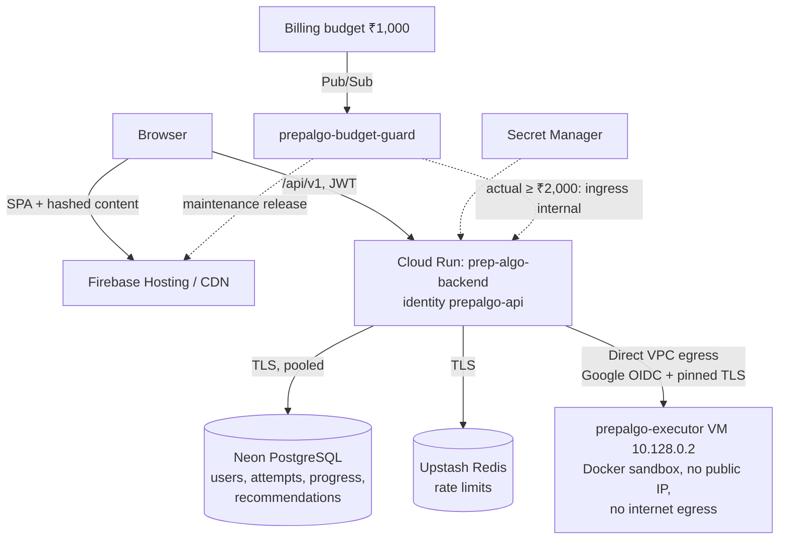
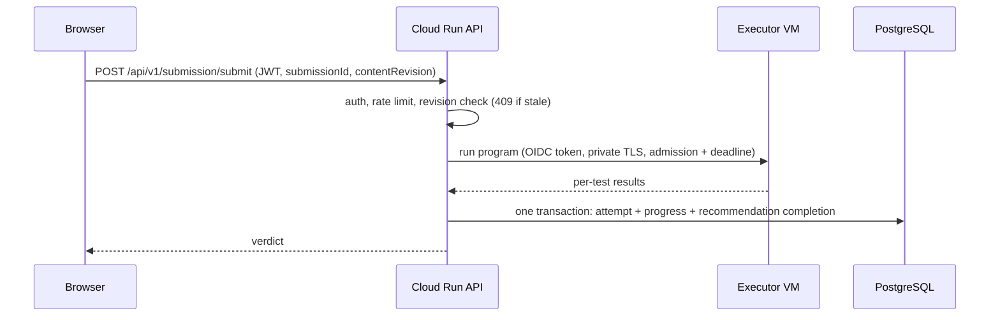

# PrepAlgo — Architecture

The current system. Operations (deploy, promote, rollback, executor updates,
budget guard) live in [DEPLOYMENT_README.md](../DEPLOYMENT_README.md); design
rationale lives in the [ADRs](adr/). Phase history (MongoDB, BullMQ, gateway
plans) is archived in [archive/ARCHITECTURE_PLAN.md](archive/ARCHITECTURE_PLAN.md).

## Overview

| Concern | Implementation |
| --- | --- |
| Frontend | React 18 + Vite SPA (Redux + Saga, styled-components, Monaco) on Firebase Hosting `prepalgo.web.app` |
| Content | Authored in `content/`, compiled to hashed CDN artifacts plus private grading bundles ([ADR-009](adr/009-content-in-git.md)) |
| API | Express (Node 22, ESM) on Cloud Run `prep-algo-backend`, us-central1, scale to zero, identity `prepalgo-api` |
| User data | Neon PostgreSQL: users, attempts, progress, profiles, recommendation batches |
| Shared state | Upstash Redis for distributed rate limits only, with per-instance fallback ([ADR-002](adr/002-redis-integration.md), [ADR-003](adr/003-distributed-rate-limiter.md)) |
| Caching | Bounded process-local cache for public catalog reads; private routes are `no-store` ([ADR-004](adr/004-caching-strategy.md)) |
| Code execution | Private Docker executor VM, no public IP, reached over Direct VPC with Google OIDC + pinned TLS ([ADR-008](adr/008-code-execution-sandbox.md)) |
| Auth | Google sign-in → application JWT; `protect` middleware, ownership checks ([ADR-001](adr/001-auth-middleware.md)) |
| Resilience | PostgreSQL circuit breaker, execution admission/deadlines, live/ready split ([ADR-006](adr/006-circuit-breaker.md), [ADR-007](adr/007-observability.md)) |
| Cost protection | Billing budget emails + budget guard shutoff/maintenance page ([scripts/budget-guard](../scripts/budget-guard/README.md)) |

Retired and removed from the code: MongoDB/Mongoose runtime and scripts,
the BullMQ execution queue ([ADR-005](adr/005-bullmq-async-processing.md)),
the Redis response cache, database-hosted content and email/password signup.

## Content pipeline

`content/` (problems, quizzes, topics, modules; validated by `content/schema.js`)
is the source of truth. `npm run build:content` (`scripts/content/build.mjs`)
emits two gitignored outputs:

- `frontend/public/content/` — public, content-hashed JSON (`manifest.json` →
  `index.*.json` → `items/<slug>.<hash>.json`). Browsing issues zero API calls.
- `backend/content/` — `catalog.json` (public item bodies plus release
  revision), `testcases.json` and `quiz-answers.json`. Answer keys never reach
  the CDN.

At startup the API syncs stable content identities into PostgreSQL
(`content_refs`) once per content revision, under an advisory lock. Both deploy
scripts build content first, and Hosting publication refuses to run unless the
live backend reports the same content revision.

## Request flows

Execution admission is one active submission per API process, eight waiting,
a 2 s queue wait and a 15 s end-to-end deadline; overload returns 503 with
`Retry-After`, never a fabricated verdict. Production refuses local execution:
without `CODE_EXECUTOR_URL` the execution routes return 503.

Health: `/health/live` makes no dependency calls; `/health/ready` runs a bounded
`SELECT 1` (used sparingly so Neon can sleep); `/health` reports release
identity, PostgreSQL pool/breaker, Redis and execution load.

## Data model and semantics

Schema lives in `backend/migrations/` (`NNN_name.sql`, applied explicitly with
`npm --prefix backend run db:migrate`; startup refuses pending migrations and
tolerates newer ones for rollback). Migrations follow expand/contract (see
[DEPLOYMENT_README.md](../DEPLOYMENT_README.md#rollback)).

- Code and MCQ grading endpoints record passing and failing attempts. A short
  transaction appends the attempt, updates progress and completes matching
  daily assignments on a pass; grading runs outside the transaction.
- `submissionId` (client UUID) deduplicates retries; reusing it with a
  different payload returns 409. Optional `contentRevision` binds a submission
  to the displayed question; a mismatch returns 409 before execution.
- `timeTaken` is optional untrusted seconds (0–86,400) and part of the
  idempotency hash; only successful timed attempts update the running average.
- `solveCount` counts successful submissions, `attemptCount` all submissions.
  Struggle/mastery heuristics use attempts. Daily activity, assignments, expiry
  and streaks use UTC; a streak stays current through yesterday.
- `POST /api/v1/solveHistory` accepts annotations only (`note`, `tags`,
  `difficultyRating`). History supports `cursor`/`nextCursor` keyset paging
  (offset remains for older clients) and returns the latest 20 attempts per item.
- GET daily recommendations initializes a missing batch idempotently and never
  replaces an existing one; refresh is the POST endpoint. Details:
  [RECOMMENDATIONS.md](RECOMMENDATIONS.md).

## Executor isolation

`backend/executor/server.js` runs on a dedicated VM (`prepalgo-executor`,
10.128.0.2) as a systemd service behind Caddy TLS. It accepts only Google ID
tokens for the audience `https://executor.prepalgo.com` from callers in
`EXECUTOR_CALLERS`, refuses to start with application secrets in its
environment, and runs every program in a pinned-digest Docker image with no
network, a read-only filesystem, dropped capabilities and memory/CPU/time
limits. It is packaged by `scripts/executor/package.mjs` (allowlisted files
only) and maintained via `scripts/executor/patch-window.sh` and
`rotate-cert.sh`; a monthly GitHub Action opens reminder issues. Details:
[ADR-008](adr/008-code-execution-sandbox.md).

## Open items

- **Backups (deferred, Gate 5):** only manual, verified point-in-time logical
  backups exist. Establish recurring, off-device recovery before real-user
  onboarding.
- **Separate dev/prod databases (deferred, Gate 6):** the shared Neon database
  is testing data; split development and production databases/credentials
  before onboarding real users.
- No `/metrics` endpoint or active paid alert policies (templates in
  `scripts/monitoring/` are intentionally unapplied).
- Capacity: concurrency/instance limits are a conservative testing baseline,
  not measured throughput; see the operational acceptance list in
  [DEPLOYMENT_README.md](../DEPLOYMENT_README.md#operational-acceptance-before-increasing-scale).
- Roadmap not started: guided study paths (Phase 4), AI review/mock interviews
  (Phase 5), the [SD interview workspace](SD_INTERVIEW_DESIGN.md).
