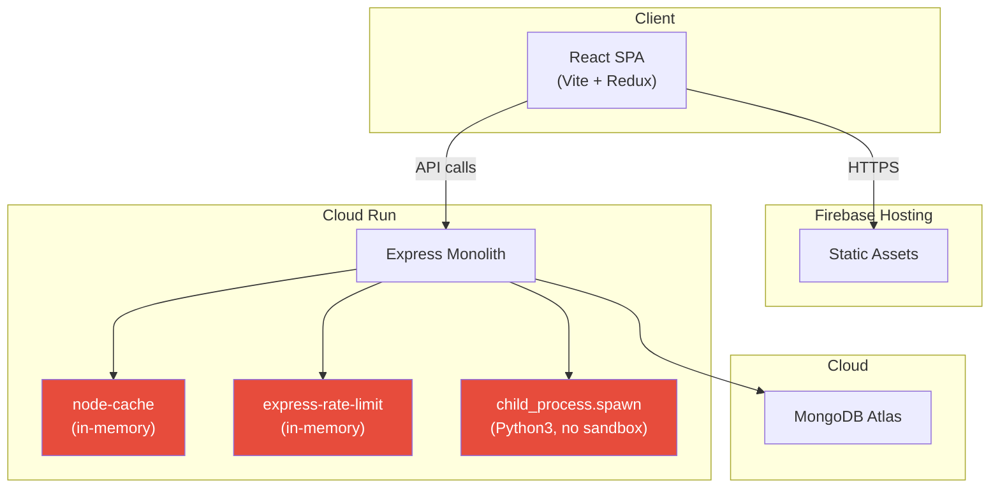
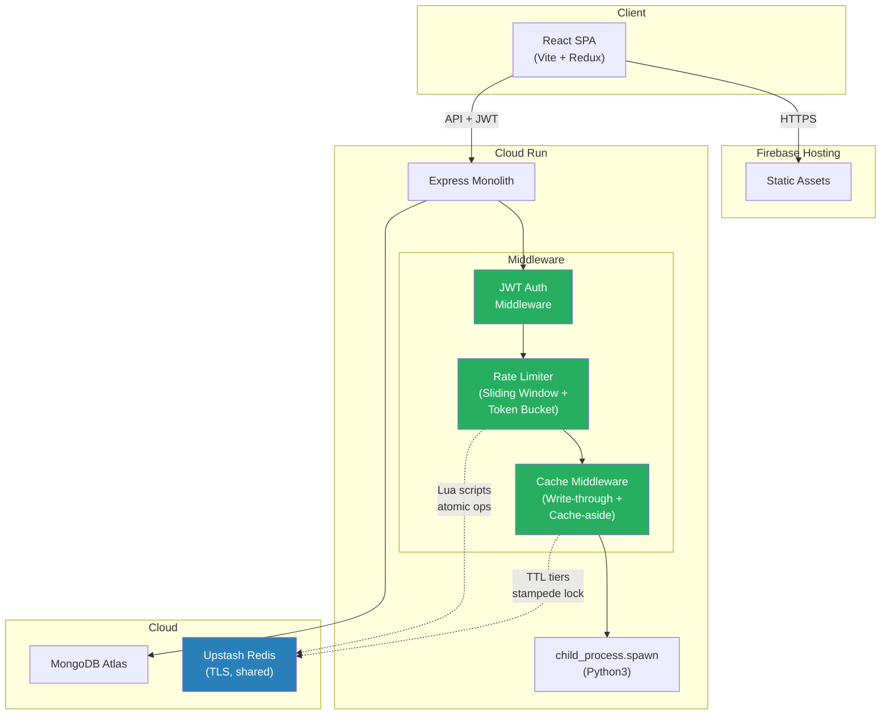
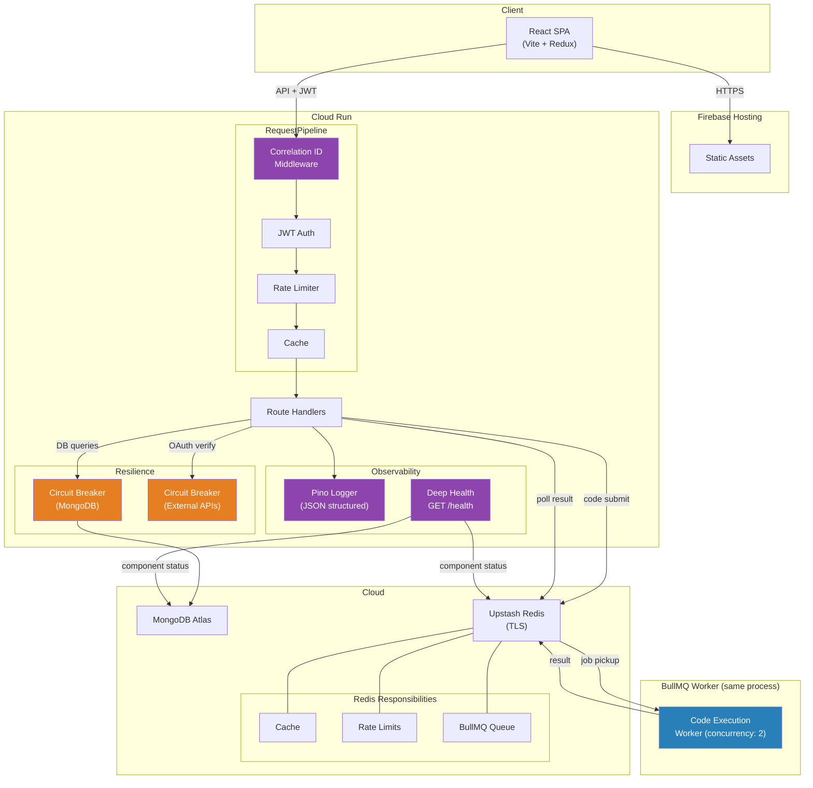
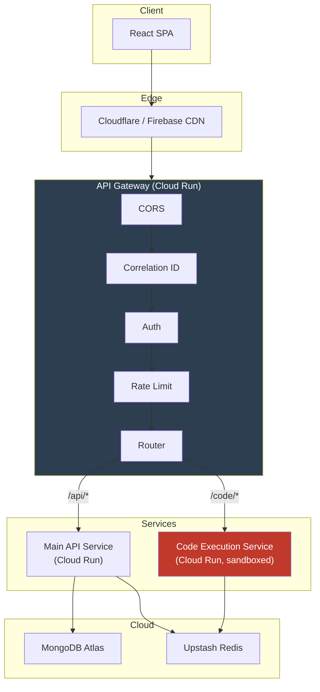
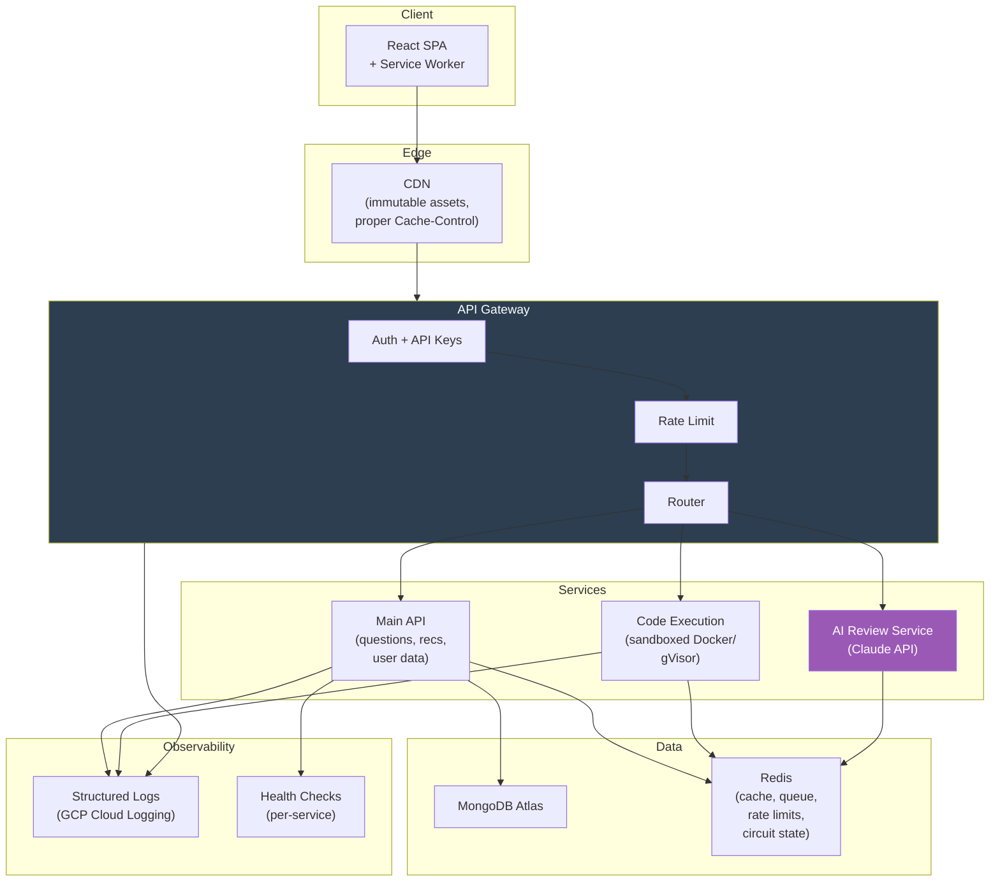
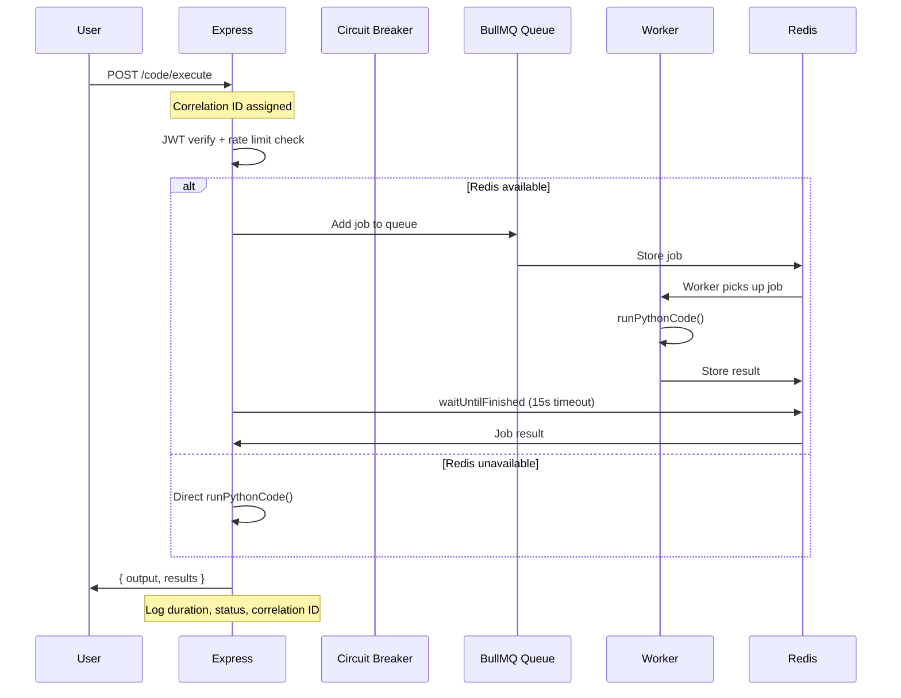
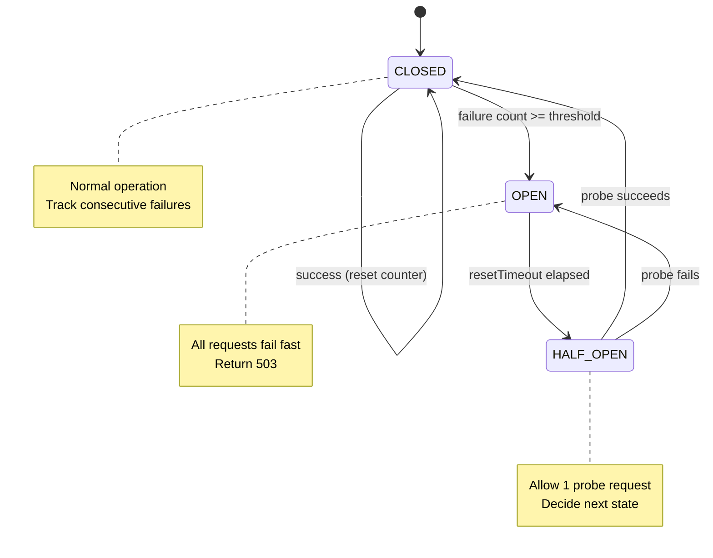

# PrepAlgo — Architecture Evolution Diagrams

Visual reference for each phase of the architecture. All diagrams use Mermaid.

---

## Phase 1: Monolith (Baseline)

**Problems**: In-memory cache/rate limiter reset on cold start, not shared across instances. No auth middleware. Code execution blocks request thread. No observability.

---

## Phase 2a: Security + Redis Foundation (Complete)

**What changed**: Google OAuth + JWT auth on all protected routes. Redis replaces in-memory cache and rate limiter. Sliding window (API) + token bucket (code exec) rate limiting with Lua scripts. Write-through + cache-aside patterns with stampede protection.

**ADRs**: 001-auth, 002-redis, 003-rate-limiter, 004-caching

---

## Phase 2b: Async Processing + Resilience (Complete)

**What changed**: BullMQ async code execution (graceful fallback to direct when Redis down). Custom three-state circuit breakers on MongoDB and external APIs. Pino structured logging with correlation IDs. Deep health check with component-level status.

**ADRs**: 005-bullmq, 006-circuit-breaker, 007-observability

---

## Phase 2c: Gateway + Service Extraction (Planned)

---

## Target State (All Phases)

---

## Request Flow: Code Execution (Phase 2b)

---

## Circuit Breaker State Machine

---

## Cost Efficiency Notes

| Component | Cost Strategy |
|-----------|--------------|
| **Upstash Redis** | Pay-per-command. BullMQ connections use dedicated config (maxRetriesPerRequest: null). Job retention: 10 completed, 10 failed — minimizes Redis memory |
| **Pino Logging** | `info` level in prod (no debug logs shipped). GCP Cloud Logging auto-ingests JSON from stdout — no extra agent or service |
| **Circuit Breaker** | Pure in-memory state machine. Zero external calls for state tracking |
| **BullMQ Worker** | Runs in-process (no separate Cloud Run service). Concurrency: 2 — limits memory without needing extra instances |
| **MongoDB Atlas** | Compound indexes + denormalized fields reduce query count. Circuit breaker prevents wasted retries during outage |
| **Cloud Run** | Min instances: 0 (scale to zero when idle). Graceful degradation means partial Redis outage doesn't force scaling |
